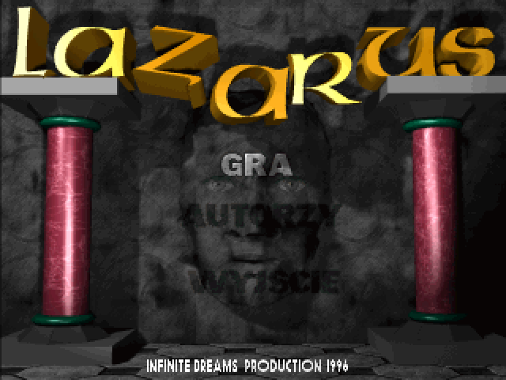
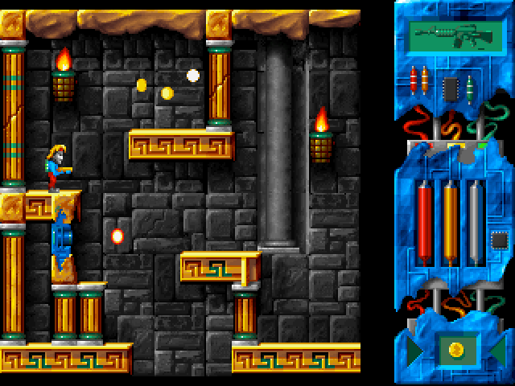
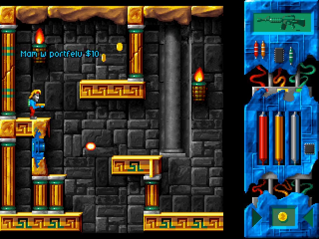
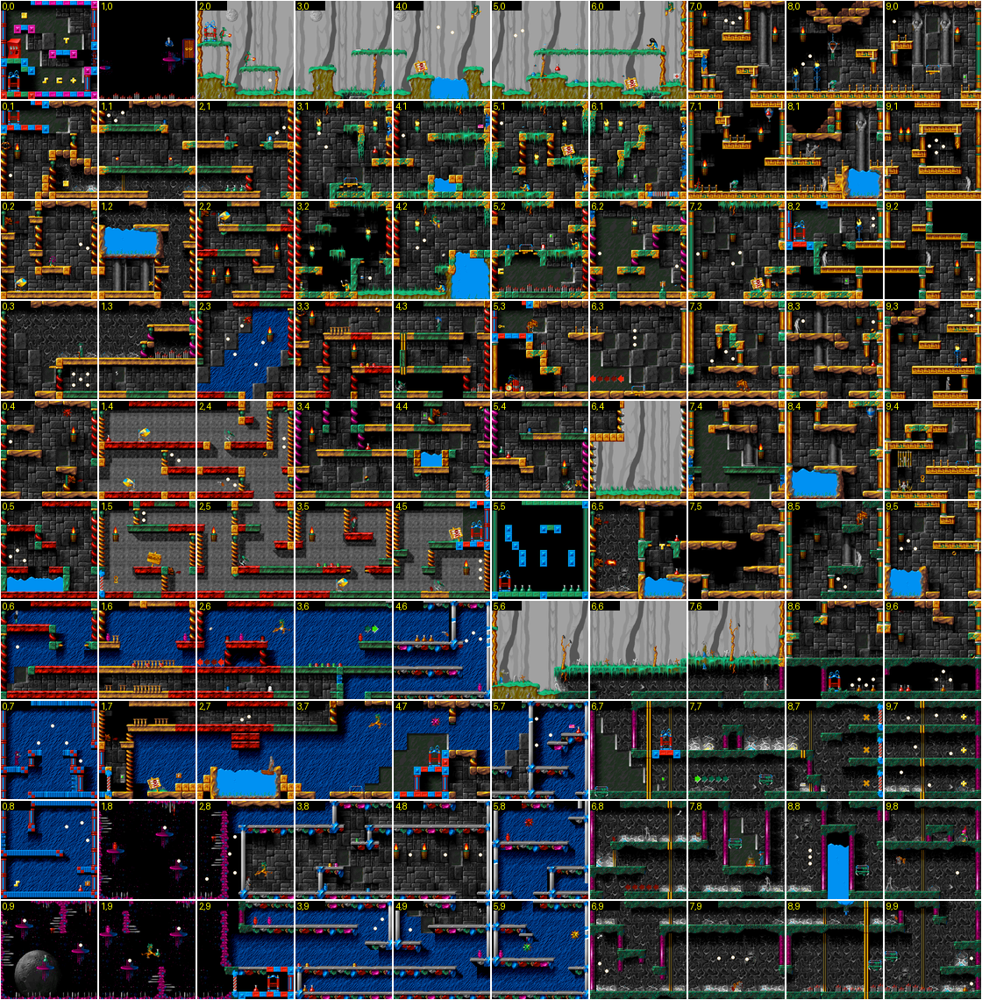

# Lazarus remake

Groundwork for a modern remake of **Lazarus** (Infinite Dreams, 1996, MS-DOS, Polish), a room-based
action-adventure platformer with a jetpack, guns, inventory puzzles and Polish humour.

| title | gameplay | dialogue |
|---|---|---|
|  |  |  |

## What is here

* [`docs/reverse-engineering/`](docs/reverse-engineering/README.md) — complete write-up of the executable,
  every data file format, the engine rules and physics constants, and the full game content (items, NPCs,
  quests, endings), plus notes for the remake.
* [`assets/`](assets/README.md) — every asset of the original converted to modern formats: tilesets,
  sprites with animation/collision metadata, all 100 rooms as JSON and **Tiled** maps (+ world file),
  world maps, WAV sound effects, MOD music, intro/ending animation frames, pictures, a BMFont of the
  dialogue font, all texts (UTF-8 + translation CSV) and game tables (weapons, items, scripts, physics).
* [`reference/`](reference/README.md) — annotated Ghidra decompilation of `LAZARUS.EXE` for porting exact
  behaviour.
* [`tools/`](tools/) — the Python tools that produced all of the above from the original files.



## Regenerating

The original `LAZARUS.EXE` / `DATAxx.RES` files are not in git. Put your copy in `original/` (ignored) and:

```bash
pip install -r tools/requirements.txt
python3 tools/extract_assets.py original/ assets/
python3 tools/dump_rooms.py original/ --quests
```

## License

The code and documentation in this repository are MIT licensed (see `LICENSE`). Lazarus and its assets
(`assets/`, `reference/`) are the property of their respective rights holders and are included at the
repository owner's request.
