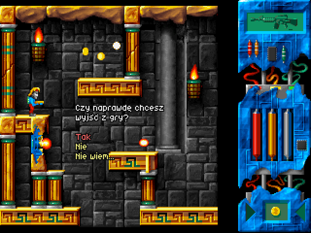

# 3. Engine and game mechanics

Everything here is taken from the decompiled code; constants are given in the original units
(pixels, ticks at **50 Hz**, 16.16 fixed point where noted) so a remake can match the feel exactly.

## 3.1 Timing and screen

* Game logic runs at a fixed **50 ticks per second** (timer interrupt). `CZYTAJ.TO` says the meter
  should read 50. There is no delta-time anywhere — one tick = one update.
* Video: Mode X **320×240×256**. Play-field 224×228 at (0,6); HUD panel 76×240 at x=244; x=224–243
  is black. Text windows are drawn over the play-field.

| start room (7,0) | dialogue | menu |
|---|---|---|
|  |  |  |

*Screenshots of the original in DOSBox (`docs/images/screenshots/`).*
* Intro/ending/pictures switch between Mode 13h (320×200 FLC/PCX), Mode X (320×240 FLC) and
  mode 12h (640×480×16 PCX: game over, endings, credits scroller).

## 3.2 World structure

* A 10×10 grid of single-screen rooms (no scrolling). Leaving the play-field edge moves to the
  neighbouring room (`Hero_MoveCollide`, `0x232C4`):
  * left: `x + 11 < 0` → `col-1`, hero `x = 213`
  * right: `x + 11 > 224` → `col+1`, hero `x = -11`
  * up: `y < 0` → `row-1`, hero `y = 197`
  * down: `y + 15 > 228` → `row+1`, hero `y = 0`
  * at the world border the hero is clamped instead.
* Collision checks look into neighbouring rooms' tiles when the probe is outside the current room, so
  walking across room boundaries is seamless.
* `EnterRoom(col,row)` (`0x29304`) destroys the previous room's objects and creates: one `TileAnim`
  per NEWROOM entry, then one `RoomObject` per OBJECTS.BIN record. Object *state* lives in the loaded
  OBJECTS.BIN buffer (flags, HP), so collected items stay collected and opened doors stay open.
  Enemies' HP is reset each time their path restarts (`hdr[9]` → `hdr[8]`).

## 3.3 Tiles and collision

* Layers per room: background (7×6 tiles 32×38, opaque) → platform tiles (14×12 tiles 16×19,
  colour 0 transparent) → animated tiles (foreground flag `0x80` = drawn in the second pass, over
  sprites) → sprites.
* `TileCollide(x0,y0,x1,y1,col,row)` (`0x230FC`): look up the tile's type (DATA32):
  * `2` passable → no collision;
  * box test against the tile's PSIZES rectangle (DATA38) at `(col*16, row*19)`;
  * `1` harmful → **hero is hit** (see 3.6) but not blocked;
  * otherwise (`4`) → solid.
* Movement is resolved axis by axis: X first (blocked → flag 1), then Y (blocked → flag 2), testing the
  3×3 tile neighbourhood of the hero's box. Then every object with collision class `0x40` (solid
  platform) is tested; touching one sets flag 4 (used by the jetpack bounce and lifts).
* "On ground" = the 1-pixel gravity probe each tick did not move the hero down.
* Solid objects (class `0x40`: lifts, moving platforms, doors) push the hero out of their box; when the hero
  stands on one that is moving, the platform's per-tick displacement is added to the hero (`0x228C4`) and
  he counts as grounded.

## 3.4 The hero

### Controls (scancodes in `ProcessInput`)

| key | action |
|---|---|
| ← / → | walk (or thrust sideways with the jetpack) |
| ↑ | jump (hold for full height) / jetpack thrust up; menu cursor up |
| ↓ | crouch — picks up floor items (objects with interaction bit `0x04`); menu cursor down |
| Ctrl | fire (hold for auto-fire weapons) |
| Space | toggle jetpack on/off (only with fuel > 0) |
| Enter | *use*: activate the object you stand at, else use the selected inventory item |
| `,` / `.` | previous / next inventory slot |
| 1–6 | select weapon (if owned) |
| Esc | "Czy naprawdę chcesz wyjść z gry?" (Tak / Nie / Nie wiem) |

Dialogue boxes wait for Ctrl, Enter or Space. Menus: ↑/↓ (wrapping), Home/End, confirm with Enter.
There is no pause key — message 279 *"Pauza. Naciśnij fire."* exists but is never referenced.

### State machine (`Hero_Think` → table at `0x7D310`, 16 states, even = facing left, odd = right)

| state | name | entry sprite (global frame / group) | notes |
|---|---|---|---|
| 0/1 | stand | 1025 / 1027 (groups 204/205) | |
| 2/3 | walk | frames 3 / 14 (groups 0/1) | footstep sound 46 on ticks 18 and 35 of a 37-tick cycle |
| 4/5 | jump | 1005 (group 199) | |
| 6/7 | fall | 1005 | |
| 8/9 | jetpack | 1005 / 1009 (199/200) | sounds 27 (idle loop) / 28 (thrust loop) |
| 10/11 | crouch | 1013 (201…) | plays forward while ↓ held, backwards on release |
| 12/13 | — | | empty (unused) |
| 14 | teleport out | 1089 (group 211) | sound 41; at the end moves to the destination room |
| 15 | teleport in | 1105 (group 211, reversed) | then back to standing |

Transitions every tick (for stand/walk): `inputY < 0` → jump; not on ground → fall; `inputX` → walk;
jetpack on → jetpack; ↓ → crouch.

### Physics constants

| quantity | value |
|---|---|
| walk speed | **1 px/tick** (50 px/s); air control while jumping/falling: same 1 px/tick |
| gravity probe on ground | +1 px/tick |
| jump initial velocity | `0xFFFB1DF3` = **−4.883 px/tick** |
| gravity (jump/fall) | `0x3851` = **+0.2200 px/tick²** |
| jump | continues **only while ↑ is held** and v ≤ 0 → variable height; max ≈ 64 px (26 ticks) |
| fall speed cap | `0xA0000` = 10 px/tick (+1 = 11 px/tick moved) |
| jetpack start | vy = −2.0 |
| jetpack thrust | ±`0x1800` = 0.09375 px/tick² per held direction (x and up) |
| jetpack gravity | +`0x1000` = 0.0625 px/tick² when ↑ not held |
| jetpack friction (x) | `0x400` = 0.0156 px/tick² towards 0 when ←/→ released |
| jetpack speed cap | ±3.0 px/tick on both axes |
| jetpack collision | velocity on the blocked axis is **halved and reversed** (bounce) |
| fuel use | `0x800` per tick in jetpack mode → full tank (`0x2F0000`) = 1504 ticks ≈ **30 s** |

No fall damage.

### Energy and damage (`Hero_DamageTick`, `0x24ADC`)

* Energy, fuel and each weapon's ammo use the same scale: max `0x2F0000`, shown as a 47-pixel tube.
* The hero is "hit" while overlapping a harmful object (class `0x10`) or a harmful tile.
* While hit: every **4 ticks** energy −= `0x6000` (0.375 of 47 units), a hurt sound (cycle 50,50,53,51,51,52,…)
  plays, and the sprite flashes (colours 0x1D/0x14). Continuous contact kills a full-energy hero in ~10 s.
* Energy < 0 → death: game over (`g_heroDead = 1`). There are **no lives** and no save game.
* `IDMORT` / `/E` disables damage.

### Interaction (`Object_Interact`, `0x23E0C`)

Each tick the hero's box is tested against all objects with class `0x20` (usable). On overlap the object
activates if: it has the *touch* flag, **or** *use* (Enter) was pressed, **or** it is a crouch-pickup and
↓ is held. Then, if the object is *conditional*:

* needs-item (`interact & 2`): the selected inventory item must equal `hdr[13]`; otherwise the
  **"missing item" handler** for that item id runs (e.g. *"Potrzebuję czerwonej karty żeby to
  uruchomić"*);
* needs-flag (`flags & 4`): `g_gameFlags[hdr[13]]` must be set, else nothing happens.

Pressing *use* when not touching anything calls the **item-use handler** of the selected pocket
(usually prints the item description; some items do something — see the content document).

## 3.5 Room objects (`RoomObject`)

Behaviour is entirely data-driven by OBJECTS.BIN (format in 2.7). Per tick (`Object_Think`, `0x23F4C`):

1. if not activated: advance the animation (group frames with per-frame durations) and integrate the
   current path step (`v += a; pos += v`); when the step's tick count is reached, go to the next step
   (playing/stopping its sound, possibly activating another object) or apply the end mode;
2. if activated: play the activation animation once (e.g. explosion), play `hdr[5]` sound, then:
   * fire the trigger (`flags & 0x4000`): activate object `hdr[12]` (< 20) or set
     `g_gameFlags[hdr[12]]` and run **script `hdr[12]`**; if `flags & 0x10` also activate object
     `index+1`;
   * unless *keep*: hide the object (it is gone); with *rearm* it resets its path and stays.

Bullets test objects with mask `0x78`. `hit(damage)`:
`HP 0xFF` → bullet absorbed, no damage; class `0x20` or `HP 0xFE` → bullet passes; else flash white,
`HP -= damage`, at 0 → activate (death animation + trigger). 127 objects in the game are killable
enemies (HP 1–48; one boss-like object has 192).

Typical object recipes found in the data:

| kind | class | flags / header |
|---|---|---|
| coin (+$1) | usable | touch, fires script 224, end mode loop, activation anim 118, sound 33 |
| patrolling enemy | harmful | path with velocities, HP, activation anim 9 (explosion), sound 5 |
| turret shot | harmful, HP 0xFE | steps: hidden wait → fly at 3 px/tick → hidden; synchronized animated tile = cannon |
| floor pickup | usable | interact bit 4 (crouch), fires script that gives an item |
| card door | usable + solid pair | reader needs item (card), fires script 255 (consume item), chains to the door object |
| NPC | usable | touch or *use*; fires a dialogue script; conditional on a quest item |
| ambient sound | inert, invisible | never-ending path whose steps only play sounds |

## 3.6 Weapons and projectiles

Weapon table at `0x5427C`, one entry per weapon and facing (12 × 0x24 bytes). Bullets spawn at
hero `+(-8,10)` facing left / `+(16,10)` facing right, move with `v += a; x += v`, die on a solid tile,
the play-field edge, an object hit, or after `lifetime` ticks; then play the impact animation.

| # | key | speed px/tick | accel | cool-down (ticks) | dmg | lifetime | ammo per shot | shots per full bar | auto | notes |
|---|---|---|---|---|---|---|---|---|---|---|
| 0 | 1 | 16 | 0 | 7 | 1 | ∞ | `0x800` | 1504 | no | starting gun |
| 1 | 2 | 1 → | +0.375 | 0 | 2 | ∞ | `0x1000` | 752 | no | rocket (accelerates) |
| 2 | 3 | 1 → | +0.375 | 0 | 3 | ∞ | `0x4000` | 188 | no | heavy rocket |
| 3 | 4 | 16 | 0 | 3 | 2 | ∞ | `0x4000` | 188 | yes | **Uzi** (shop, $20) |
| 4 | 5 | 4 → | +0.125 | 3 | 3 | 10 | `0x8000` | 94 | yes | flame-thrower (short range) |
| 5 | 6 | 1.5 | 0 | 100 | 100 | ∞ | `0x50000` | 9 | no | big plasma bomb |

Shot sounds cycle through per-weapon lists (e.g. weapon 0: 20,20,21,20,22,21,22). Weapon pickups (group
135) call scripts 225–229 which grant weapon 1–5, select it and add 3 × ⅓ of ammo. Magazines (item 36,
"Magazynek", shop $2) refill ⅓ of the current weapon's ammo when *used*.

## 3.7 HUD (`0x2C618`, redrawn when flagged dirty)

| element | position | source |
|---|---|---|
| energy tube | (260, 111), 47 px high, fills from the bottom | frames 1084 (empty) / 1085 (fill) |
| ammo tube (current weapon) | (276, 111) | 1084 / 1087 |
| fuel tube | (292, 111) | 1084 / 1086 |
| weapon picture | (255, 8) | frame `1064 + weapon*2` (group 209) |
| selected inventory item | (276, 204) | frame `1034 + item.hud_icon` (group 208) |

## 3.8 Dialogue / UI system

* `Dlg_Begin` pauses sound effects and draws into a separate text buffer over the frozen play-field;
  `Dlg_Say(n)` prints message *n* (position/colour from its `{x}{y}{c}` codes), waits for a key and clears;
  `Dlg_Menu` draws up to 6 options (selected one in colour 0x10, others 1) and returns the choice (↑/↓, Home/End, Enter).
* `ShowPicture(frame)` fades to black, shows a sprite frame centred with palette DATA27, waits, fades back
  (maps and riddles).
* Speech balloons in the intro are part of the FLC (DATA17 style) – not engine features.

## 3.9 Sound

* Drivers: Gravis UltraSound (hardware mixing), Sound Blaster 1/2/Pro/16 (software mixing at 28 kHz),
  or silent. A single MOD plays at a time; up to 32 effect voices.
* Sound effect ids index the DATA41 table (2.9). Objects can start/stop looping effects from path steps;
  the engine remembers which looping effect an object started so it can stop it.

## 3.10 Palette effects

* Fades between palettes in 3–15 steps (room entry, pictures, menus).
* **Bomb**: palette fades to DATA16 (red alarm), looping tick sound 16, `g_bombTimer = 3000` ticks
  (60 s). At 0 → explosion: white flash, fade to the red-only palette, death.
* Death by explosion and the herbs ending use their own fades.

## 3.11 Randomisation at new game (`0x2C300`)

| variable | range | used by |
|---|---|---|
| bomb wire | 0–2 | which wire (red/green/blue) defuses the bomb; hinted by the hanging man |
| secret door | 0–2 | which of three doors in Zaświaty hides a magic key; hinted by the man saved from the monster |
| sock location | 0–10 | which chest (11 rooms listed in the EXE) holds the sock |
| riddle | 0–2 | which number riddle the riddle-man asks (answers **14**, **19**, **97**) |
| shop map | 0–1 | which map picture the shop's "Mapa" shows (frames 1078/1079, group 210) |

New-game state: energy full, fuel 0, $10, weapon 0 only, all ammo full, inventory = wallet, teleport
passwords known: Zapomniana Świątynia and Sala treningowa, start room (7,0).
