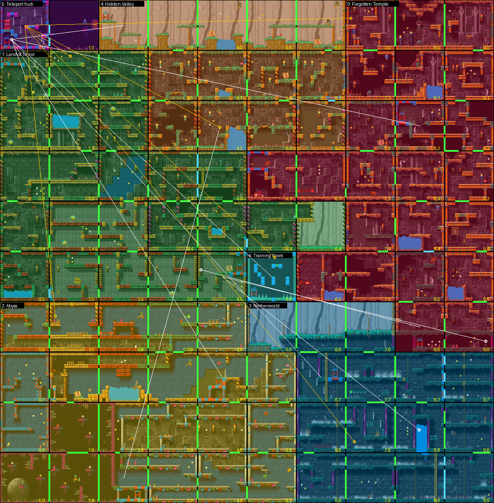
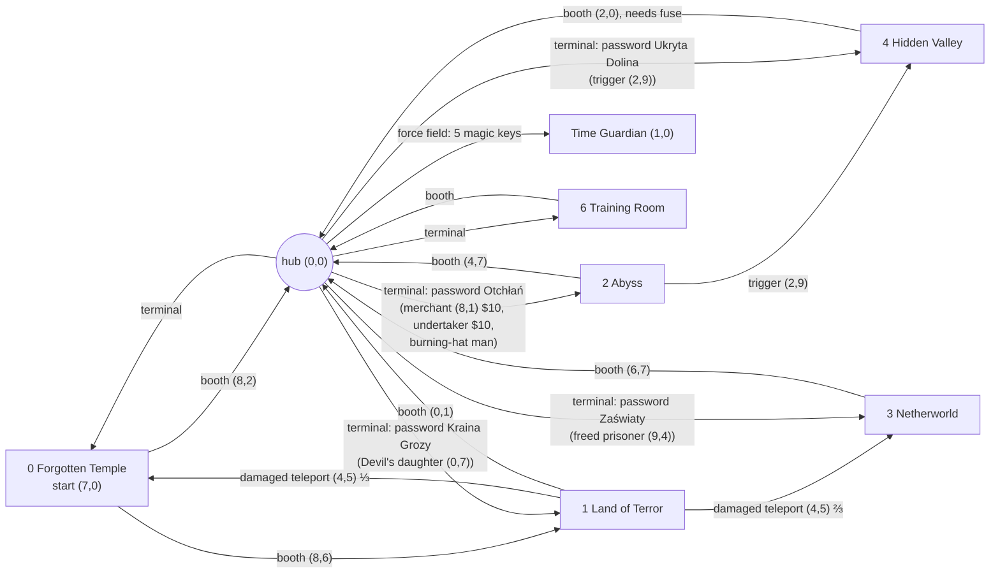
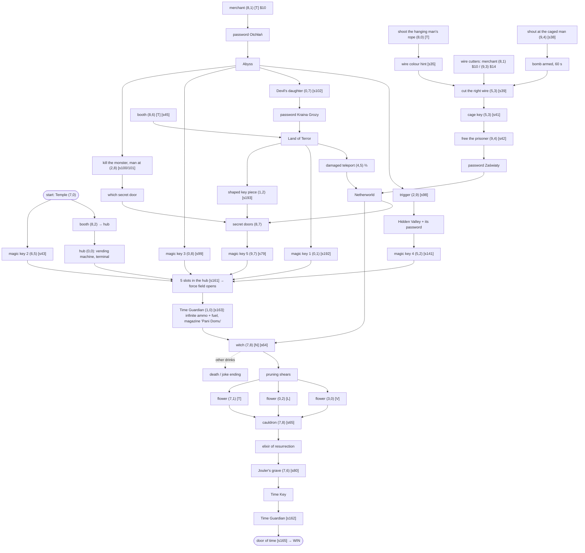

# 7. World structure and catalogues

Data-derived views of the game for level design and balancing in the remake. Everything here is generated
by [`tools/world_analysis.py`](../../tools/world_analysis.py) and [`tools/catalogues.py`](../../tools/catalogues.py)
(run as part of `extract_assets.py`); the machine-readable versions are in `assets/gamedata/`:

| file | content |
|---|---|
| `world_graph.json` | every room edge (open?, pixel openings, doors/lifts on it), regions, teleports, secret passages |
| `enemies.json` | every harmful or shootable object: HP, hits to kill per weapon, path speed/extent, death trigger |
| `hero.json` | hero states, animations (frames, durations, boxes), physics, transitions, start state |
| `sound_usage.json` | for each of the 54 sound ids: who plays it, and which ids share one sample |
| `unused_content.json` | sprites, sounds, texts, tiles, sequences, files the game never uses; known bugs |

## 7.1 Regions

An edge between two rooms is **open** when a gap at least as large as the hero's collision box (11×29 px,
`(6,2)-(16,30)` inside his sprite) crosses the shared border, using the tile collision rules of 3.3. The
connected components of open edges are the game's **regions** — and they match the teleport network
exactly: every region is entered through a teleport and none is connected to another on foot.

*`assets/rooms/world_regions.png` — regions tinted, open edges green (cyan when a door or lift sits on the
opening), white lines = teleport booths/scripted teleports, yellow = hub terminal destinations.*

| # | region (menu name) | rooms | arrival | way back to the hub |
|---|---|---|---|---|
| 0 | Forgotten Temple (Zapomniana Świątynia) | 23: (7–9,0–2), (5–9,3), (7–9,4), (6–9,5), (8–9,6) | (7,0) — game start | booth (8,2) |
| 1 | Land of Terror (Kraina Grozy) | 23: (0–2,1–2), (0–4,3), (0–6,4), (0–4,5) | (1,1) | booth (0,1) |
| 2 | Abyss (Otchłań) | 23: (0–4,6), (0–5,7–9) | (1,6) | booth (4,7) |
| 3 | Netherworld (Zaświaty) | 15: (5–7,6), (6–9,7–9) | (7,8) | booth (6,7) |
| 4 | Hidden Valley (Ukryta Dolina) | 13: (2–6,0), (3–6,1–2) | (4,2) | booth (2,0) — works only after the fuse is fitted (script 132) |
| 5 | Teleport hub | (0,0) + Time Guardian (1,0) behind the force field | (0,0) | — |
| 6 | Training Room (Sala treningowa) | (5,5) | (5,5) | booth (5,5) |

Scripted teleports besides the booths and the hub terminal (all `Hero_StartTeleport` calls in the EXE):

* (8,6) Temple → (4,5) Land of Terror (script 45) — an unconditional booth, so the Land of Terror is
  reachable from the start without its password;
* (4,5) damaged teleport (script 203) → (9,6) Temple with p = ⅓, else (8,8) Netherworld — a way into the
  Netherworld without the Zaświaty password;
* (2,9) Abyss trigger (script 98) → (4,2) Hidden Valley, and it teaches that password.

## 7.2 Gates inside regions

Solid objects (doors, lifts, force fields) that sit on an open edge (`gated_by` in `world_graph.json`). Only
four of them actually cut rooms off; the rest are shortcuts or obstacles.

| edge | gate | opened by | cuts off |
|---|---|---|---|
| (0,0)→(1,0) | force field (object 12) | the 5th magic key in the hub slots (script 161) | the Time Guardian (1,0) |
| (8,7)→(9,7) | three secret doors | the shaped key piece (item 12); the right door is random | (9,7) — magic key 5 |
| (6,1)↓(6,2) | lift platform | purple card (item 3) in the reader at (6,1) | (6,2) — fuel can |
| (4,4)→(5,4) | door pair | switch in the same room | (5,4), (6,4) — the teddy bear |
| (0,5)→(1,5) | door pair | golden key (item 23) at (1,5), consumed (script 255) | nothing — (0,5) is also reachable from (0,4) |
| (3,3)→(4,3), (8,4)↓(8,5), (8,9)→(9,9) | invisible blocker, trigger zone, moving lifts | — | nothing |

## 7.3 Secret passages (animated tiles never block)

`TileCollide` reads only the static NEWROOM tile map. Animated tiles are separate objects whose
`TileAnim_Overlaps` is only ever asked by the hero's *harm* test (class mask `0x11`): an animated tile can
hurt the hero (when its current frame is a harmful tile type) but **never blocks anybody**. The designers
used this for fake walls: a foreground animated tile that looks solid, placed on an empty map cell, is
walked through and hides the hero while he is inside it.

`world_graph.json → fake_walls` lists all **40** such cells (an animated tile with a solid-looking frame
over a non-solid map cell), e.g. the wall between (7,4) and (8,4) in the Temple, the column at (8,4)
`col 0`, (6,5) — without them the Temple would fall apart into two regions. In the debug renders they are
outlined in magenta. A remake must not give animated tiles collision.

## 7.4 Debug renders

* `assets/rooms/debug/room_C_R.png` (2×): room art darkened; solid tile boxes blue, harmful red; animated
  tiles yellow (fake walls magenta); every object's box and full path in its class colour (harmful red,
  usable green, solid cyan, inert grey; dotted while the object is hidden), labelled with its object index;
  open room edges green / cyan.
* `assets/rooms/world_collision.png`: the whole world, collision and paths only.

## 7.5 Enemies

`enemies.json` classifies the 262 harmful-or-shootable objects with the rules of `Object_Hit` (3.5):

| kind | count | rule |
|---|---|---|
| enemy | 155 | harmful, takes damage: HP 1–192 (127 objects) or **HP 0 = dies to any hit** (28: darts, falling stones, small bugs…) |
| hazard, bullets pass | 81 | HP `0xFE`: water/acid drips (55), turret fireballs (15), sparks, debris |
| hazard, absorbs bullets | 23 | HP `0xFF`: indestructible bouncing bombs, some mines |
| destructible | 3 | harmless but shootable: the rope of the hanging man, two blue capsules |

Contact with anything harmful costs `0x6000` energy every 4 ticks (3.4) — there is no per-enemy damage.
Hits to kill = ⌈HP / damage⌉ with damage 1 (starting gun), 2 (rocket, Uzi), 3 (heavy rocket, flame-thrower),
100 (plasma). Enemies never aim or chase: every one follows its scripted path (speeds below are the
fastest per-tick movement along the path). HP is restored whenever the path restarts.

| enemy (visual name) | sprite groups | count | HP | max px/tick | rooms |
|---|---|---|---|---|---|
| white energy ball | 30 | 19 | 0–15 | 5.1 | (3,1) (4,1) (5,1) (6,1) (1,3) … |
| red bug | 160 | 12 | 0–48 | 5.4 | (3,3) (3,5) (1,6) (3,6) (3,8) … |
| red / green / magenta / yellow spiked mine | 169 / 171 / 170 / 172 | 20 | 4–10 | 4.5 | (2,3) (0,4) (5,8) (5,9) |
| small dart | 152 | 9 | 0 | 7.3 | (3,0) (5,0) (6,0) (7,1) (8,4) |
| black spider | 164 | 6 | 0–48 | 6.6 | (9,2) (6,3) (9,3) (9,6) |
| green / orange / pink bug | 163 / 162 / 161 | 11 | 3–48 | 5.8 | (3,3) (3,5) (3,6) (3,8) (3,9) |
| grey ghoul | 150/151 | 6 | 3–32 | 0.2 | (8,1) (9,1) (8,2) (9,2) (8,3) (8,5) |
| thrown bone | 177/178 | 6 | 0–1 | 3.3 | (7,7) (6,8) (6,9) |
| winged gargoyle | 154/155 | 5 | 8–23 | 0.5 | (4,3) (2,4) (5,4) (2,5) (4,5) |
| hooded hunchback | 146/147 | 5 | 32–48 | 0.7 | (0,2) (2,2) (1,4) (3,5) |
| falling stone | 45 | 4 | 0 | 4.5 | (6,0) (4,2) (2,6) |
| orange ring | 165 | 4 | 0–21 | 3.4 | (9,1) (7,3) (2,4) (9,5) |
| green slime (flying / blob / bouncing) | 185 / 16 / 27 | 8 | 7–19 | 3.5 | (5,0) (2,2) (4,4) (2,5) (4,5) … |
| dragon | 191/192 | 4 | 16–48 | 1.9 | (2,6) (3,7) (2,8) (1,9) |
| zombie | 156/157 | 4 | 10–15 | 0.2 | (5,6) (6,6) (7,6) |
| orange beast | 2/168 | 4 | 6–19 | 0.5 | (5,3) (7,3) (8,3) (8,5) |
| skeleton | 136/137 | 3 | 6–9 | 0.6 | (6,8) (7,8) (9,8) |
| green parrot | 13/14 | 3 | 2–15 | 3.2 | (4,0) (6,0) (4,2) |
| blue beetle | 15 | 3 | 0–3 | 3.9 | (5,0) (3,8) |
| kneeling hag | 197 | 3 | 9–19 | 0.4 | (6,0) (5,1) (4,2) |
| small arrow | 179 | 3 | 0 | 2.5 | (5,6) (7,6) |
| lizard man | 193 | 2 | 19 | 0 | (2,0) |
| helmeted skeleton warrior | 149 | 2 | 5 | 0.7 | (8,0) (7,1) |
| caveman with a club | 3 | 2 | 8–31 | 0.4 | (3,2) (5,2) |
| bouncing bomb (shootable ones) | 176 | 2 | 19–24 | 5.5 | (3,4) (4,4) |
| orange crawler | 158/159 | 2 | 0–4 | 5.7 | (9,8) (7,9) |
| blue wall turret | 56 | 1 | 9 | 0 | (6,1) |
| metal ball | 31 | 1 | 7 | 1.3 | (3,2) |
| **green stone pillar** | 173 | 1 | **192** | 0.2 | (4,3) — 192 pistol shots, 2 plasma shots |

Visual names are guesses from the sprites (`lazarus_names.py` marks them with `?`); group numbers are exact.

## 7.6 Sounds

* The 54 sound ids use only **23 distinct samples** — most effects are one sample played at several rates
  (e.g. ids 11–14 and 16 are the same sample at 8–14 kHz; the four hurt sounds 50–53 likewise).
  `same_sample_as` / `pitch_variants` in `sound_usage.json`; a remake can load 23 files and vary pitch.
* Played by engine code: 46 footstep/landing, 27/28 jetpack loops, 41 teleport, 40 empty-weapon click,
  16 bomb ticking, 5/6 bomb explosion, 38 magazine reload; weapons and the hurt cycle come from EXE tables;
  everything else from object data (activation sound or path-step play/stop commands).
* Never played: **47, 48, 49** — the explosion sample (also ids 6 and 10) at 4.4/5.1/5.9 kHz.

## 7.7 Unused and cut content

* **Sprites** (`assets/sprites/unused_groups.png`): a 14-frame parrot-like flying creature (39, + a single
  frame 37), a firing blue wall turret (57/59 — the only turret placed uses the one-frame group 56; the
  other cannons are animated tiles with turret-shot objects), a mushroom-cloud explosion ending in a skull
  (212, 11 frames — the bomb death only flashes the palette), the hero turning to face the camera (203) and
  standing with a gun (207), white flash ovals (206), green drops/leaves (189/190), small grey birds or fish
  (180/181) and two tiny fragments (17, 26).
* **Texts**: 279 *"Pauza. Naciśnij fire."* (there is no pause) and 183 *"Chyba wiem o co chodzi!"*.
* **Tiles**: 22 platform tiles and 6 background tiles never placed; tile-animation sequences 5, 55 and 60.
* **Engine**: hero states 12/13 are empty; files DATA18 (old tile types), DATA37 (old PSIZES) and DATA19
  (palette) are never loaded.
* **Bugs**: re-reading the riddle scroll when riddle 2 was drawn shows riddle 1's picture (4.8); the riddle
  check accepts option 1 for riddles 0–1 and option 2 for riddle 2, which is right only because of the
  option order.

## 7.8 Quest dependency graph

Items (pocket ids, 4.3) and scripts (`[sNN]`) behind each step; locations in (col,row) with the region in
brackets. Everything not on a path to the WIN node is optional (money, shortcuts, jokes).

Optional chains not shown: fuse (5,2) → fuse box (2,0) repairs the Hidden Valley booth [s132]; first-aid kit
(6,0) → bleeding man (3,2) → red card → reader (5,2); purple card (4,1) → lift (6,1); lift card → lift (9,0);
bucket (7,8) → tap (8,9) → burning-hat man (9,8) → magic whistle (+ password Otchłań) → *use* it in (1,5)
"TARAPATY" → golden key → door (1,5); random chest in the Abyss → sock → sock man (0,6) → decoder →
gum-chewer (3,5); riddle man (0,3) → answer → platforms at (1,3); teddy bear (5,4) → girl (4,3) → $100 →
ferry ticket $95 → ferryman (2,7). The exact order the designers intended was reconstructed from data
(5.5); the region graph above shows which steps are reachable from the start.
