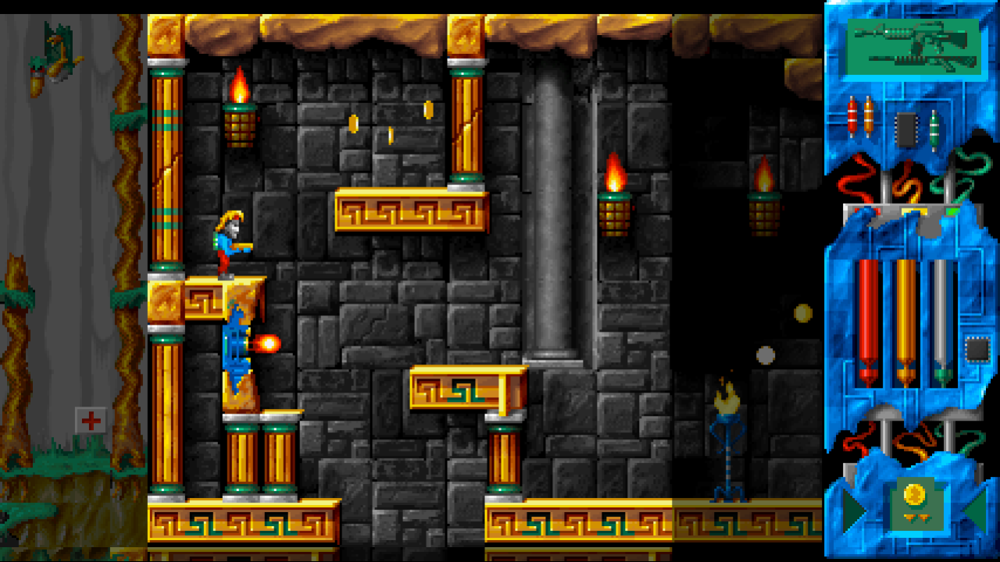

# Lazarus — Godot 4 remake

A remake of **Lazarus** (Infinite Dreams, 1996) in **Godot 4.7**, playable in a web browser, widescreen and
HD, with keyboard, gamepad and on-screen touch controls.

**Play: <https://mbialkowski.github.io/claude-sandbox/>** (built and published from `main` by CI).



## Design

* **Same rules as the original.** The hero (states, jump/fall/jetpack physics, all-or-nothing tile
  collision), the room objects (paths, animations, activation, triggers, chained objects, solid platforms
  that push and carry), shots, damage, the inventory and every quest/dialogue handler are ported from the
  decompilation (`reference/lazarus.c`) and run at the original's fixed **50 Hz** with its integer /
  16.16 arithmetic. The handlers run from `assets/gamedata/script_logic.json` (docs 4.9).
* **Rendered like a VGA game.** Everything is drawn in palette indices into a 240-pixel-high off-screen
  image and coloured by a shader with the current palette, so the original's palette fades, the bomb's
  alarm palette and the explosion flashes are exact. The shader scales with "sharp bilinear" filtering:
  crisp pixels of even size at any HD resolution.
* **Widescreen.** The logical screen is as wide as the window (320–640 px for 240 px height). The hero's
  room is centred, the neighbouring rooms are visible (dimmed) around it and the original HUD panel sits at
  the right; the camera glides when the hero walks into the next room. Only the hero's room is live, as in
  the original — its neighbours are shown as they look on entry and come alive when he walks in.
  On 4:3 screens it looks like the original.
* **Room edges like the original.** By default the hero crosses room edges exactly as in the original
  (Hero_MoveCollide: placed fully inside the new room, a 14–30 px jump at top/bottom edges, which also
  gives jumps a small boost the level design may rely on). Options → *Room edges: seamless* treats the
  world as one continuous map instead (the hero changes room when his middle crosses the edge).

* **Intro and endings.** The original's 110-second intro (FLC animations and scrolling story pages, with
  *recollection*) plays at start-up with the original timings — with English subtitles for the painted-in
  Polish text when the language is English; Space/Esc/a tap skips it. The credits animation, the game-over
  picture, the joke ending and the winning ending with the credits scroller are there too. In the browser a
  "press a key" screen comes first (browsers only start audio after an input); it also picks the language
  (Polski / English: arrow keys, a click or a tap).
* **Music while playing.** The original is silent during the game (its two modules play only in the intro,
  the title menu and the end credits). The remake plays *recollection* and *multifruit juice* in turn while
  you play; Options → *Music while playing* turns it off for the original's silence.

Details that differ from the original on purpose: shots touching harmful tiles do not hurt the hero (an
original bug); the bullets of the hero's room are drawn clipped to it; there is a pause menu (the
original's unused "Pauza" text exists) and an options screen; music while playing (above). The game starts
in Polish with the original texts; English (`data/text_en.json`) can be chosen on the first screen or in
the options.

## Controls

| action | keyboard | gamepad | touch |
|---|---|---|---|
| walk | ← → (or A D) | d-pad / left stick | pad |
| jump / jetpack thrust, menu up | ↑ (or W) | A, d-pad up | SKOK (JUMP), pad up |
| crouch (pick up), menu down | ↓ (or S) | d-pad down | pad down |
| fire | Ctrl (or J, X) | X, right trigger | STRZAŁ (FIRE) |
| use / talk / confirm | Enter (or E, K) | B | UŻYJ (USE), tap |
| jetpack on/off | Space (or L) | Y | PLECAK (JET) |
| previous / next item | , . (or Q, Tab) | LB / RB | RZECZ (ITEM), tap the HUD item |
| weapon | 1–6, R = next | Back | BROŃ (GUN), tap the HUD weapon |
| pause / options | Esc (or P) | Start | II |
| full screen | F11, Alt+Enter | | [ ], options |

Dialogues continue with Fire, Enter, Space or a tap. The original's cheats work (`IDMORT`, `IDSIAR`,
`IDLUFA`, `IDBULL`). The game is saved each time the hero enters a room; **Continue** on the title screen
resumes from there (the original had no saving: one death was game over).

## Running

```bash
python3 tools/build_remake_data.py original/ remake/data/      # only after changing the converter
godot --path remake                                            # play (Godot 4.7, "Compatibility" renderer)
godot --headless --path remake --export-release Web remake/build/web/index.html
```

The web export is single-threaded (no special HTTP headers needed), so `remake/build/web/` can be served
by any static web server or GitHub Pages; it installs as a full-screen landscape app (PWA) on phones.
Export templates: Godot 4.7.2 (`Editor → Manage Export Templates`).

Sound in the browser starts with the first key, click or tap. A small script in the page head (the Web
preset's `html/head_include`) resumes it after every input (browsers suspend audio after calls or app
switches) and makes it play while an iPhone is in silent mode, which otherwise mutes web audio.

## Tests

```bash
godot --headless --path remake --script res://tests/check.gd       # every script parses
godot --headless --path remake --script res://tests/golden.gd      # 63/63 golden traces (hero + objects)
godot --headless --path remake --script res://tests/scenarios.gd   # coins, shop, save/load, shooting, teleport, death
godot --headless --path remake --script res://tests/walkthrough.gd # the solver's winning route, 109 steps
godot --path remake -- --shots=/tmp/shots                          # screenshots of title, start, walk
node remake/tests/web_smoke.mjs remake/build/web /tmp/web-shots    # web build in headless Chromium
```

`golden.gd` replays `assets/gamedata/golden_traces.json` (made by `tools/reference_sim.py` from the
decompiled movement code) through the remake's hero and objects and compares every tick.
`walkthrough.gd` replays `assets/gamedata/walkthrough.json` (`tools/completability.py`) through the remake's
room objects and script VM — every item, lock, chain, flag and handler on the way to the Door of Time —
and must end with the winning ending. CI (`.github/workflows/remake-web.yml`) runs all of them, exports the
web build and publishes it on GitHub Pages from `main` (<https://mbialkowski.github.io/claude-sandbox/>;
the repository's Pages source must be "GitHub Actions").

## Layout

| path | what |
|---|---|
| `data/` | **generated** by `tools/build_remake_data.py`: index-image atlases, rooms and object records, texts, handlers, sounds, music, pictures (never edit by hand) |
| `scripts/sim/` | the game rules: `sim.gd` (the 50 Hz GameLoop), `hero.gd`, `room.gd`, `room_object.gd`, `bullet.gd`, `state.gd` |
| `scripts/game/` | `data.gd` (loading, settings), `script_vm.gd` (quest/dialogue handlers), `audio.gd`, `strings.gd` (menu texts) |
| `scripts/view/` | `screen.gd` (indexed renderer), `palette.gd` + `palette.gdshader`, `text_layer.gd` (dialogue font), `touch.gd` |
| `scripts/main.gd` | title, options, pause, game, pictures, endings, input, layout |
| `tests/` | the tests above |

The original game's assets are included at the repository owner's request; clarify the rights before
publishing a build.
